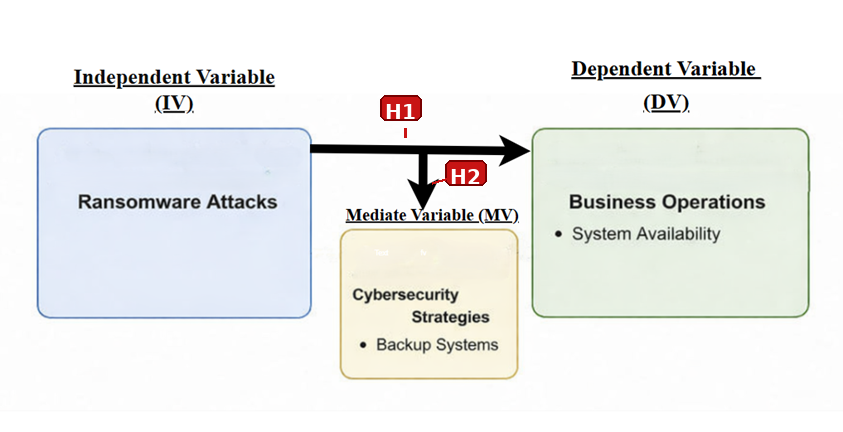
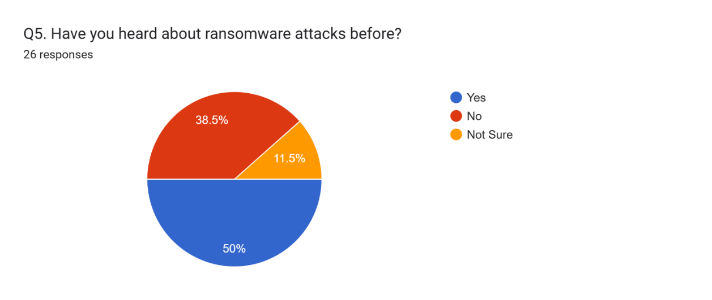
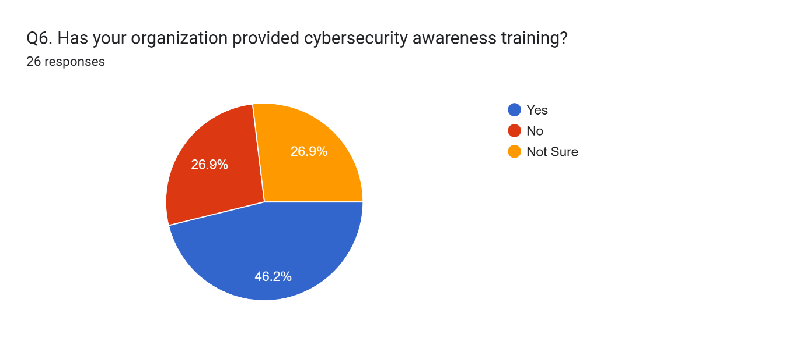
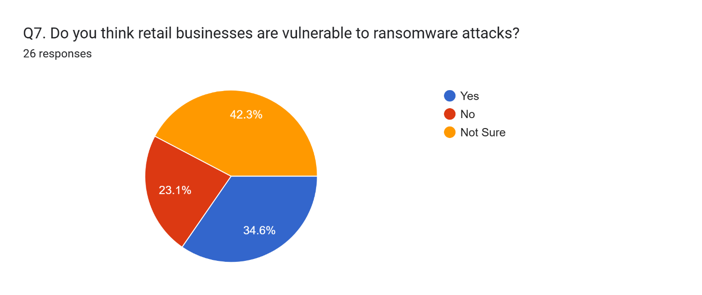
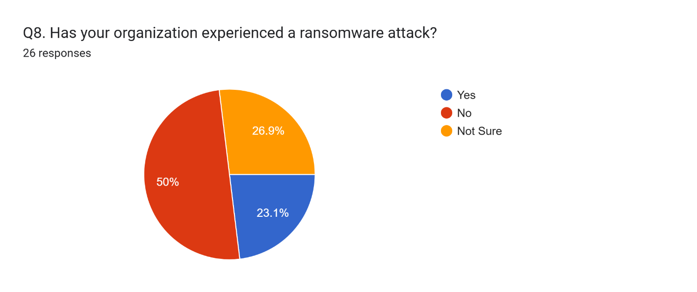
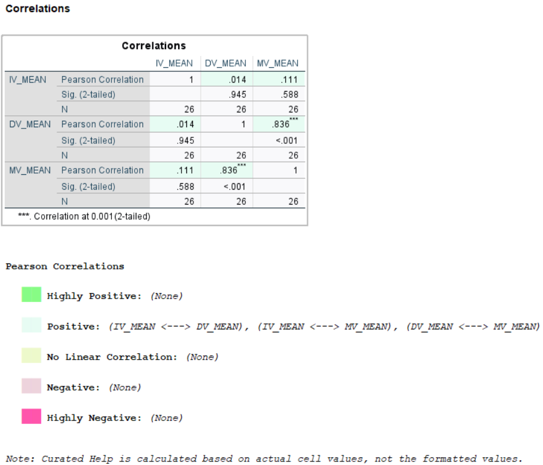
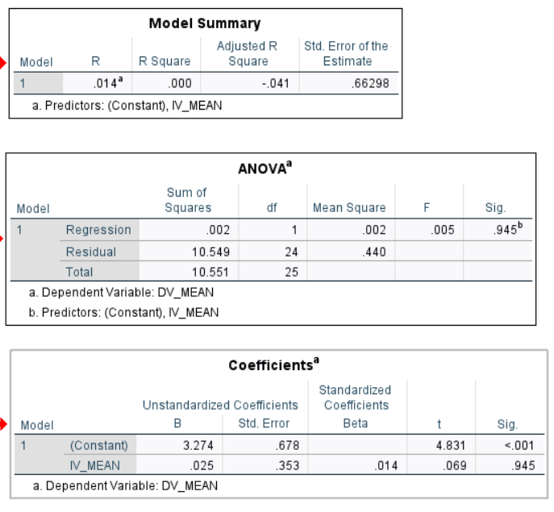

# 🔐 Effects of Ransomware Attacks on Retail Business Operations

A quantitative research project investigating how ransomware attacks affect retail business operations, and how cybersecurity strategies relate to operational resilience. Based on a **survey of 26 respondents**, analysed in **IBM SPSS**.

## 📌 Project Overview

Completed for **Unit 16: Computing Research Project II** (Pearson BTEC HND in Computing). Retail businesses depend on digital systems for sales, stock, and customer service, so ransomware can disrupt far more than IT. This study measures how employees perceive those impacts and how security measures relate to operations.

## 🎯 Research Objectives

| | Objective |
|---|---|
| RO1 | Examine ransomware risk factors, including awareness, training, and perceived vulnerability in retail |
| RO2 | Assess the effects of ransomware on everyday retail operations |
| RO3 | Evaluate the role of cybersecurity strategies in reducing ransomware risk and supporting recovery |

## 🧩 Conceptual Framework and Hypotheses

- **Independent variable (IV):** ransomware-related factors
- **Dependent variable (DV):** retail business operations
- **Mediating variable (MV):** cybersecurity strategies

| Hypothesis | Relationship |
|---|---|
| H1 | IV and DV have a significant relationship |
| H2 | IV and MV have a significant relationship |
| H3 | MV and DV have a significant relationship |

## 🔬 Methodology

- **Philosophy and approach:** positivism, deductive
- **Strategy:** survey, quantitative, cross-sectional
- **Data collection:** Google Forms questionnaire (20 questions: demographics, awareness and experience, operational impact, cybersecurity strategies, overall impact) using yes/no/not sure and 5-point Likert items
- **Sample:** 26 respondents, non-probability sampling
- **Analysis:** descriptive statistics, Cronbach's alpha reliability, Pearson correlation, and simple linear regression in IBM SPSS

📋 [View the questionnaire](survey/questionnaire.md)

## 👥 Respondents (n = 26)

IT staff were the largest group (34.6%), followed by managers and sales assistants (15.4% each), cashiers (11.5%), and other roles (23.1%). Gender was split evenly (12 male, 12 female, 2 preferred not to say), and 42.3% had 1–3 years in their organisation.

## 📊 Key Findings

### Awareness, training, and experience

- **Awareness:** 50% had heard of ransomware, 38.5% had not, and 11.5% were unsure.
- **Training:** 46.2% said their organisation provided cybersecurity training.
- **Perceived vulnerability:** only 34.6% said retail is vulnerable, and 42.3% were unsure.
- **Direct experience:** only 23.1% said their organisation had been attacked, so most answers reflect **perception, not personal experience**.

### Perceived operational impact (agree or strongly agree)

| Statement | Agree |
|---|---|
| Ransomware causes financial losses | 61.5% |
| Reduces customer service quality | 57.7% |
| Affects sales processing | 53.8% |
| Affects inventory management | 46.2% |
| Causes delays in stock availability | 38.5% |
| Reduces customer trust | 34.6% |
| Interrupts daily operations | 34.6% |

**69.2%** answered yes to whether ransomware has a significant impact on retail operations overall.

### Perceived value of security measures (agree or strongly agree)

| Statement | Agree |
|---|---|
| Strong cybersecurity helps recovery | 65.4% |
| Antivirus helps protect systems | 61.5% |
| Employee training reduces risk | 53.8% |
| Regular backups reduce impact | 38.5% |

### Statistical results

| Relationship | Pearson r | p-value | Hypothesis |
|---|---|---|---|
| IV and DV (ransomware factors and operations) | 0.014 | 0.945 | H1 not supported |
| IV and MV (ransomware factors and security strategies) | 0.111 | 0.588 | H2 not supported |
| MV and DV (security strategies and operations) | 0.836 | < 0.001 | **H3 supported** |

The regression of operations on the ransomware measure explained almost no variance (R² ≈ 0.000, F(1,24) = 0.005, p = 0.945).

## 💡 Interpretation

- Respondents see ransomware as an important retail concern and recognise several operational impacts.
- The ransomware measure showed **no significant linear relationship** with operations in this sample. This does **not** mean ransomware has no effect, as the sample is small and most respondents had no direct attack experience.
- Cybersecurity strategies and operations were **strongly correlated**, but correlation is not causation, and the strong value may partly reflect overlapping items or shared response patterns.
- Reliability of the constructed scales was low (Cronbach's alpha −0.154 for the IV and 0.484 for the DV and MV), so they should be treated as preliminary.

## ✅ Recommendations

Drawn from the findings and from literature and guidance (NCSC, NIST, Sophos), not tested directly by the survey:

- Regular cybersecurity awareness training
- Multi-factor authentication
- Regular, protected, and **tested** backups
- Patch management
- Least-privilege access
- A documented ransomware incident response plan
- Network segmentation and continuous monitoring

## ⚠️ Limitations

- **Small sample (26)** with non-probability sampling, so results can't be generalised
- Only a minority had direct ransomware experience
- **Low scale reliability**
- No qualitative data (interviews or open-ended questions) was collected
- Future work: a larger sample, a validated questionnaire, and interviews with retail IT and operations staff

## 🔒 Data and Ethics

Individual survey responses are **not published**, to protect respondent privacy. Only aggregated results are shown here.

## 📄 Documentation

- [Project presentation (pptx)](docs/ransomware-research-presentation.pptx)
- [Research report extract (docx)](docs/ransomware-research-report-extract.docx)

## 📂 Repository Contents

| File | Description |
|---|---|
| `survey/questionnaire.md` | The survey questions |
| `images/` | Framework, survey charts, and SPSS output |
| `docs/` | Presentation and report extract |

## 👤 Author

**Afry Nizam**: BSc Information Technology student, University of West London
[LinkedIn](https://www.linkedin.com/in/afrynizam) · [GitHub](https://github.com/afrynizam07)
